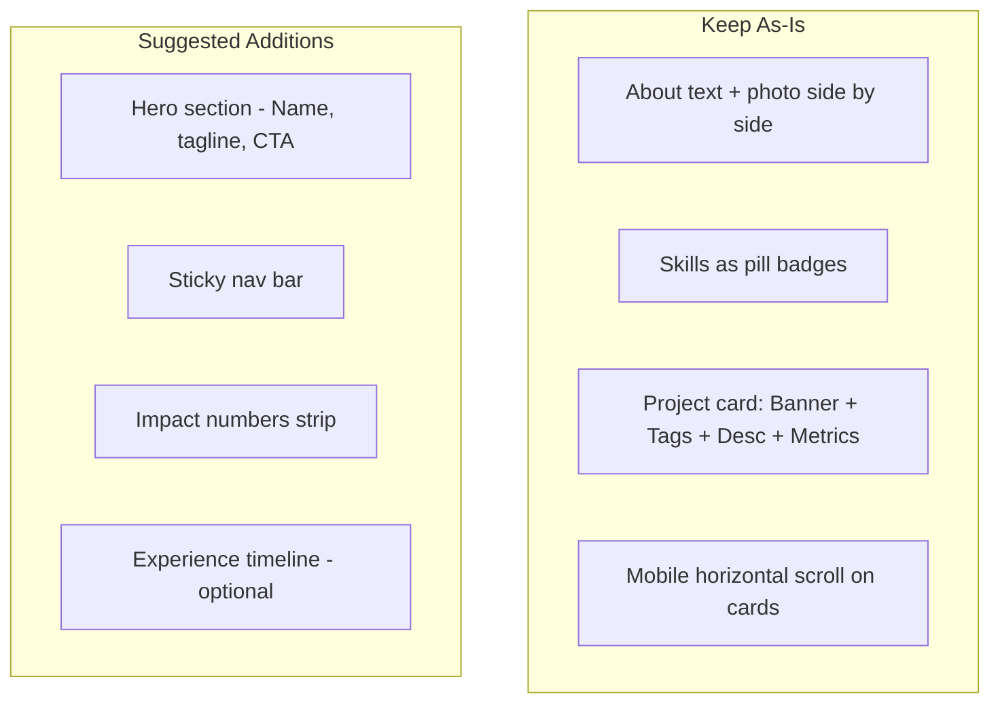
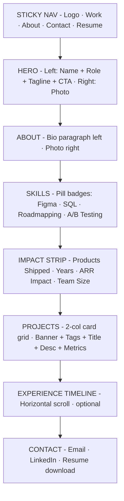
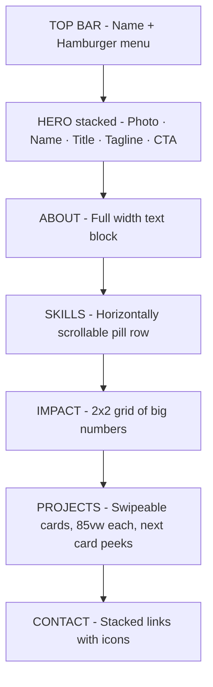
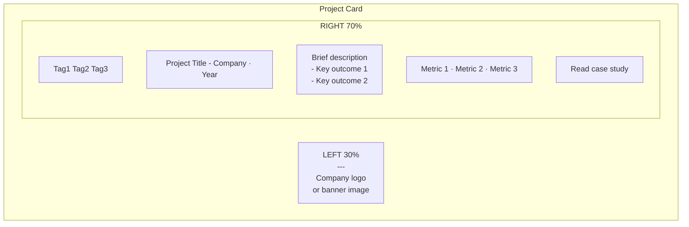
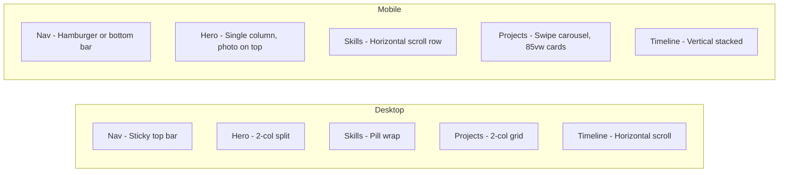
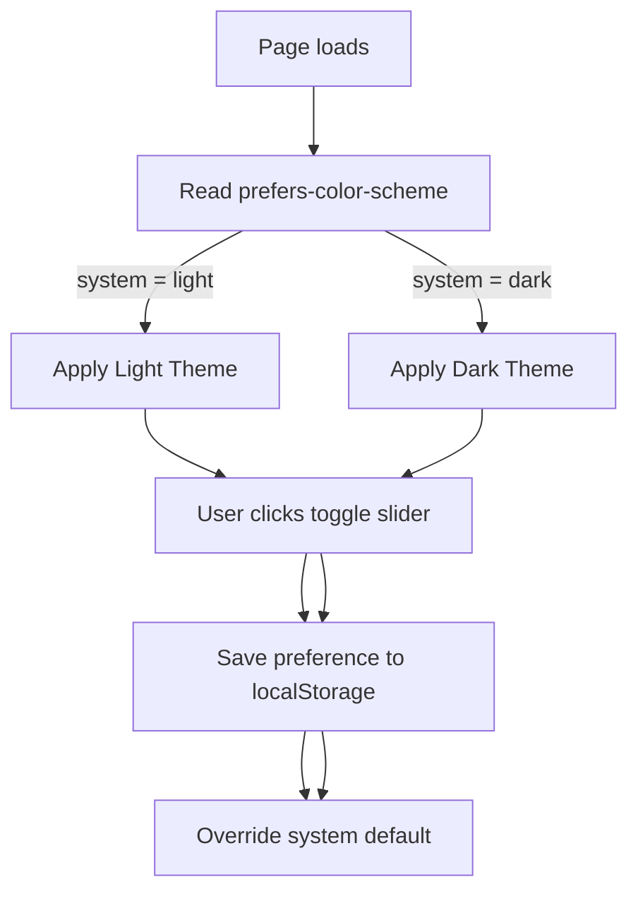
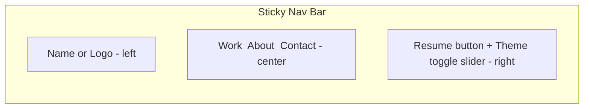
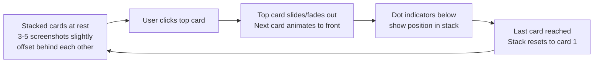

# Portfolio Plan

## What Your draw.io Wireframe Already Has

- **Desktop**: About (text left + photo right) → Skills pills → Projects (2 stacked cards with Banner + tags + description + metrics) → Contacts
- **Mobile**: Same flow, single column, horizontal scroll indicator on project cards
- **Project cards**: Left thumbnail/banner | Right: tags, title, description bullets, 3 metric highlights

---

## Your Design vs Refined Proposal

---

## Full Page Flow - Desktop

---

## Mobile Layout

---

## Project Card Anatomy

---

## Desktop vs Mobile Behaviour

---

## Key Decisions Summary

| Section | Desktop | Mobile | Status |
|---|---|---|---|
| Nav | Sticky top bar | Hamburger or bottom bar | Missing - add |
| Hero | 2-col split | Stacked, photo first | Missing - add |
| About | Text left, photo right | Full width text | Already designed |
| Skills | Pill badge wrap | Horizontal scroll row | Already designed |
| Impact strip | 4 big numbers in a row | 2x2 grid | Optional add |
| Projects | 2-col card grid | Swipe carousel, peek effect | Already designed |
| Timeline | Horizontal scroll | Vertical stacked | Optional add |
| Contact | Inline links row | Stacked icon links | Already designed |

---

---

## Theme System

### Theme Switching Behaviour

- Default: matches device `prefers-color-scheme` automatically
- Toggle: sun/moon slider in the nav bar, top right
- Persists: saves to `localStorage` so choice survives page refresh
- No flash: theme applied before first paint via inline script in `<head>`

---

### Light Theme - Color Palette

Inspired by the reference: warm off-white base, natural sage/olive accent, clean editorial feel.

| Token | Value | Usage |
|---|---|---|
| `--bg-primary` | `#FAF8F4` | Page background - warm off-white |
| `--bg-secondary` | `#F0EDE6` | Card backgrounds, section alternates |
| `--bg-accent` | `#E8E4D9` | Nav background, pill badges |
| `--text-primary` | `#1A1A1A` | Headings, body text |
| `--text-secondary` | `#5A5A5A` | Subtitles, meta info, captions |
| `--text-muted` | `#9A9A8A` | Tags, timestamps, placeholders |
| `--accent` | `#7A8C6E` | Sage green - CTAs, links, highlights |
| `--accent-hover` | `#5C6E52` | Hover state for accent elements |
| `--accent-light` | `#C8D4BE` | Pill badge backgrounds, subtle tints |
| `--border` | `#E0DDD6` | Card borders, dividers |
| `--shadow` | `rgba(0,0,0,0.06)` | Card shadows, nav shadow |

---

### Dark Theme - Color Palette

Same sage accent, inverted base — feels like the same brand in night mode.

| Token | Value | Usage |
|---|---|---|
| `--bg-primary` | `#141412` | Page background - warm near-black |
| `--bg-secondary` | `#1E1E1B` | Card backgrounds |
| `--bg-accent` | `#28281F` | Nav background, pill badges |
| `--text-primary` | `#F0EDE6` | Headings, body text |
| `--text-secondary` | `#A8A89A` | Subtitles, meta info |
| `--text-muted` | `#6A6A5A` | Tags, timestamps |
| `--accent` | `#8FA882` | Sage green - slightly lighter for dark bg |
| `--accent-hover` | `#A8C09A` | Hover state |
| `--accent-light` | `#2A3326` | Pill badge backgrounds |
| `--border` | `#2E2E28` | Card borders, dividers |
| `--shadow` | `rgba(0,0,0,0.3)` | Card shadows |

---

### Typography

| Role | Font | Weight | Size (desktop) | Size (mobile) |
|---|---|---|---|---|
| Display / Hero name | `Playfair Display` | 700 | 56px | 36px |
| Section headings | `Playfair Display` | 600 | 32px | 26px |
| Card titles | `Inter` | 600 | 20px | 18px |
| Body text | `Inter` | 400 | 16px | 15px |
| Meta / captions | `Inter` | 400 | 13px | 12px |
| Pill tags | `Inter` | 500 | 12px | 11px |
| Impact numbers | `Playfair Display` | 700 | 48px | 32px |
| Nav links | `Inter` | 500 | 14px | 14px |

- **Playfair Display** - editorial, warm, professional — matches reference tone
- **Inter** - clean, highly legible for UI and body text
- Both loaded from Google Fonts, subset to Latin only for performance

---

### Nav Bar - Theme Toggle Placement

Toggle style: pill-shaped slider with sun icon (light) and moon icon (dark), smooth CSS transition.

---

### Visual Style Rules

| Property | Value |
|---|---|
| Border radius - cards | `16px` |
| Border radius - pills | `999px` (full round) |
| Border radius - buttons | `8px` |
| Card hover | Translate up 4px + deepen shadow |
| Transition speed | `200ms ease` |
| Max content width | `1100px` centered |
| Section padding | `80px 0` desktop, `48px 0` mobile |
| Font loading | Google Fonts with `display=swap` |
| Images | All lazy loaded |

---

---

## Content Map — Neha Bendale

### Personal Details

| Field | Value |
|---|---|
| Name | Neha Bendale |
| Title | Product Manager II |
| Location | Bangalore, India |
| Email | nehabendale308@gmail.com |
| Phone | +91-9075095998 |
| LinkedIn | https://www.linkedin.com/in/nehabendale/ |
| Live Project | https://neesh.pages.dev |
| Years Experience | 6 |

---

### Hero Section

- **Headline:** Neha Bendale
- **Subline:** Product Manager II · 6 Years · Payments, Lending & AI-Native Platforms
- **Tagline:** I turn complex financial systems into products people actually use.
- **CTA 1:** See My Work (scrolls to projects)
- **CTA 2:** Resume (PDF download)
- **CTA 3:** LinkedIn (external link)

---

### Impact Strip — 4 Numbers

| Number | Label |
|---|---|
| 1.2B+ | Annual Transactions Owned |
| 90M+ | Users Served |
| 6 | Years in Fintech |
| 4 | Regulated Partner Institutions |

---

### About / Bio

Draft: Product Manager with 6 years across product engineering and product management
in payments, lending, and financial ecosystems at Bajaj Finserv.
I own systems processing 1.2B+ annual transactions for 90M+ users.
I specialise in B2B2C platform products, API-led ecosystem integrations,
and 0-to-1 product launches — working across engineering, design, risk,
compliance, and commercial stakeholders.
Currently building an AI-native personal wealth platform in private beta.

---

### Skills Pills — by Category

| Category | Skills |
|---|---|
| Payments & FinTech | Payment Gateway · Checkout · UPI · BBPS · Co-Lending · Settlement |
| Compliance & Risk | KYC · Audit Trail · RBI Compliance · Risk Controls · Regulatory Reporting |
| AI & Emerging Tech | LLMs · Generative AI · AI Agents · Prompt Engineering |
| Technical | API Design · REST APIs · SQL · Data Analytics · Mixpanel |
| Product Management | PRD · OKRs & KPIs · 0-to-1 · Roadmaps · User Stories |
| Leadership | Cross-functional Teams · Partner Ecosystems · Executive Communication |

---

### Projects / Case Studies — 5 Cards

#### Card 1 — Platform Modernization
- **Tag:** Enterprise Platform · 0-to-1
- **Title:** Unified Enterprise Platform
- **Company & Year:** Bajaj Finserv · 2025–Present
- **Summary:** Consolidating 40+ fragmented enterprise apps into one platform for 100,000+ employees. Defined API contracts, shared data models, and governance standards.
- **Metrics:** 40+ Apps Consolidated · 100K+ Users · 25%+ SLA Improvement

#### Card 2 — Co-Lending Partner Platform
- **Tag:** API Platform · Regulated FinTech
- **Title:** Strategic Co-Lending & Partner Platform
- **Company & Year:** Bajaj Finserv · 2024–2025
- **Summary:** Owned REST API contracts, KYC verification gates, and audit trail design across 4 regulated partner institutions. Ran a step-by-step onboarding process: spec review, KYC gate, sandbox testing, compliance sign-off.
- **Metrics:** 40% Faster Onboarding · 60% Less Engineering Effort · Zero Regulatory Escalations

#### Card 3 — Device Financing
- **Tag:** Lending · Risk · 0-to-1
- **Title:** Device Financing: 0-to-1 Product
- **Company & Year:** Bajaj Finserv · 2023–2024
- **Summary:** Built a 3-tier CIBIL scoring model with graduated MDM enforcement — from payment reminders to device-level controls — based on Days-Past-Due thresholds. Analyst tooling used by 300+ store ops teams.
- **Metrics:** 60% NPA Reduction · 40% Faster Investigations · 45% Fewer Escalations

#### Card 4 — Payments Platform
- **Tag:** Consumer Payments · Scale
- **Title:** Payments Platform & Checkout Optimization
- **Company & Year:** Bajaj Finserv · 2021–2023
- **Summary:** Owned the full consumer payments stack — UPI, BBPS, wallets, EMI, CDM — for 90M+ users across 25+ ecosystem partners and 5 gateway partners. Managed SLA contracts, routing logic, and NPCI/BBPS regulatory reporting.
- **Metrics:** 25% Auth Improvement · 35% NPS Lift · 10Cr+ Monthly Transactions

#### Card 5 — NEESH: Family Finance Manager
- **Tag:** AI · 0-to-1 · Self-Built · Live
- **Title:** NEESH — Family Wealth Tracker
- **Subtitle:** Never Ending Ernest Saving Hustle
- **Company & Year:** Independent · Live – Private Beta
- **Summary:** Self-hosted personal finance tracker for Indian families. Tracks investments across 11 asset classes with live NSE/BSE/AMFI price feeds. Core engine: transaction ingestion → holding recomputation → XIRR calculation → LTCG/STCG tax classification, all automated. AI-powered statement import extracts data from uploaded documents. Family accounts track spouse, parents, and kids together on one self-hosted instance.
- **Key Features:**
  - 11 asset classes: Stocks, MFs, ETFs, FDs, SGB, RSU, ESOP, ESPP, EPF/PPF, Bank Accounts, Loans
  - Transaction engine: buy/sell/bonus/split/dividend with auto holding recomputation
  - XIRR computed from full cash flow history per asset
  - LTCG/STCG auto-classified by holding period
  - Corporate actions: bonus and split with zero cost basis adjustment
  - AI import: upload statements, AI extracts transactions
  - Self-hosted: data never leaves your device
- **Metrics:** 11 Asset Classes · 20-User Private Beta · AI Statement Import
- **Live Link:** https://neesh.pages.dev
- **Screenshots (theme-matched):**
  - Dark: neesh_01_dashboard, neesh_02_portfolio, neesh_03_holdings, neesh_04_analytics, neesh_05_feature
  - Light: neesh_01_dashboard, neesh_02_analytics, neesh_03_portfolio, neesh_04_holdings, neesh_05_feature

#### Card 6 — NEESHSECRETS: Family Vault
- **Tag:** Security · 0-to-1 · Self-Built · Live
- **Title:** NEESHSECRETS — Family Vault
- **Subtitle:** Silent Encrypted Credentials, Trusted Storage
- **Company & Year:** Independent · Live
- **Summary:** Zero-knowledge, self-hosted password manager built for families. AES-256-GCM encryption runs entirely in the browser — the server is completely blind to plaintext. Designed with a family inheritance scheme: vault access can be structured so trusted family members can recover credentials if needed. Per-user private vaults on a shared device with fully offline instant search.
- **Key Features:**
  - Zero knowledge: client-side AES-256-GCM, server never sees plaintext
  - Stores: Passwords, API Keys, WiFi PSKs, Bank PINs, Recovery Codes, Secure Notes
  - Family Vaults: per-user private vaults on shared device
  - Inheritance scheme: structured vault access for family recovery
  - Instant search: fully offline, no server round-trip
  - Self-hosted: runs on BeagleBone, zero cloud dependency
- **Metrics:** AES-256-GCM Encryption · Zero Cloud Dependency · Family Inheritance Scheme
- **Live Link:** https://neeshsecrets.share.zrok.io/
- **Screenshots (theme-matched):**
  - Dark: secrets_01_list (locked vault main page), secrets_02_detail (inheritance scheme)
  - Light: secrets_01_login (locked vault main page), secrets_02_search (inheritance scheme)

---

### Stacked Screenshot Viewer — Interaction Design

Used inside Card 5 (NEESH) and Card 6 (NEESHSECRETS) project detail panels.

**Visual behaviour:**
- Cards stacked with 6px vertical offset and slight scale decrease per layer (1.0, 0.97, 0.94)
- Drop shadow increases depth perception
- Top card: click or tap to advance
- Transition: 300ms ease slide-left or fade
- Dot indicators below stack show current position
- On mobile: swipe gesture also advances
- Stack sits inside the project detail expanded view (not on the card thumbnail)

---

### Experience Timeline — 5 Roles

| Period | Role | Company |
|---|---|---|
| May 2025 – Present | Product Manager II — Platform Modernization | Bajaj Finserv, Bangalore |
| Mar 2024 – Apr 2025 | Product Manager II — Co-Lending Platform | Bajaj Finserv, Pune |
| Feb 2023 – Feb 2024 | Product Manager II — Device Financing | Bajaj Finserv, Pune |
| Sep 2021 – Jan 2023 | Product Manager — Payments Platform | Bajaj Finserv, Pune |
| Jul 2020 – Aug 2021 | Software Engineer → Product Manager | Bajaj Finserv, Pune |

---

### Achievements Strip

- A+ rating for 3 consecutive years
- 10+ awards from MD and CTO
- Overseas Incentive Award — exceeded targets by 60%

---

### Contact Section

- Email: nehabendale308@gmail.com
- LinkedIn: https://www.linkedin.com/in/nehabendale/
- Location: Bangalore, India
- Resume: PDF download link (to be hosted on Cloudflare Pages)

---

### Education & Certifications

- B.Tech: Electronics and Telecommunications, COEP Pune
- Google Cloud: Generative AI Learning Path
- IBM AI Product Management

---

## Next Steps

1. ~~Agree on layout~~ - done
2. ~~Theme and colors~~ - done
3. ~~Content mapping~~ - done
4. **Provide:** profile photo, resume PDF, any project screenshots/banners
5. **Build** - single HTML/CSS/JS file, deployable to Cloudflare Pages

